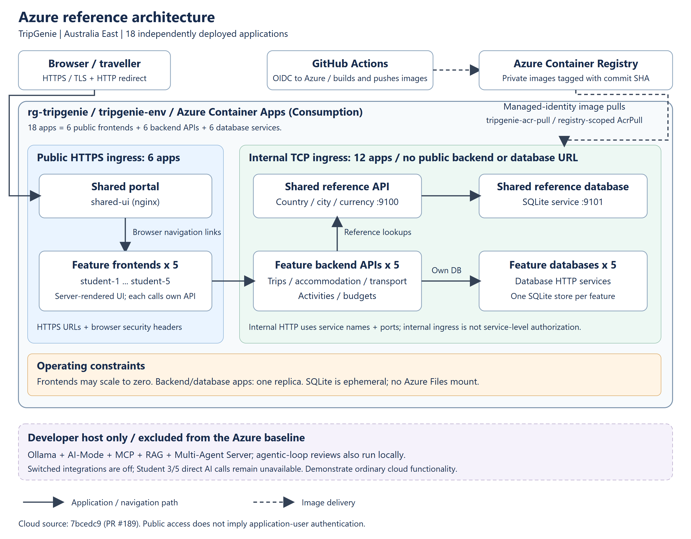
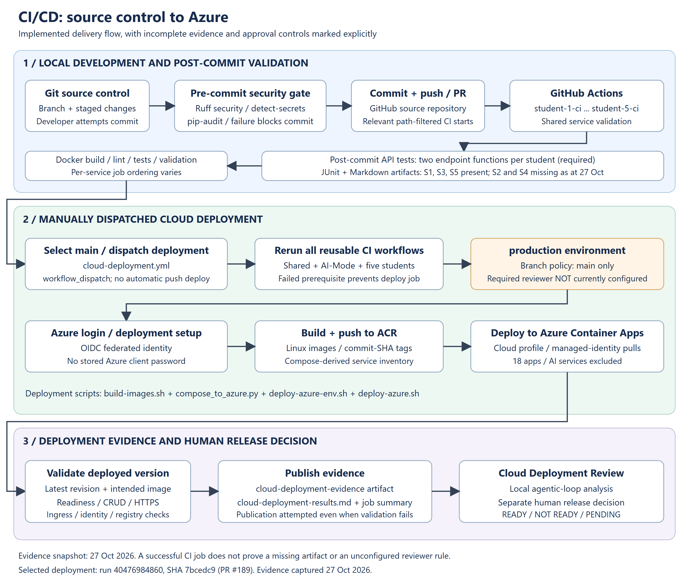
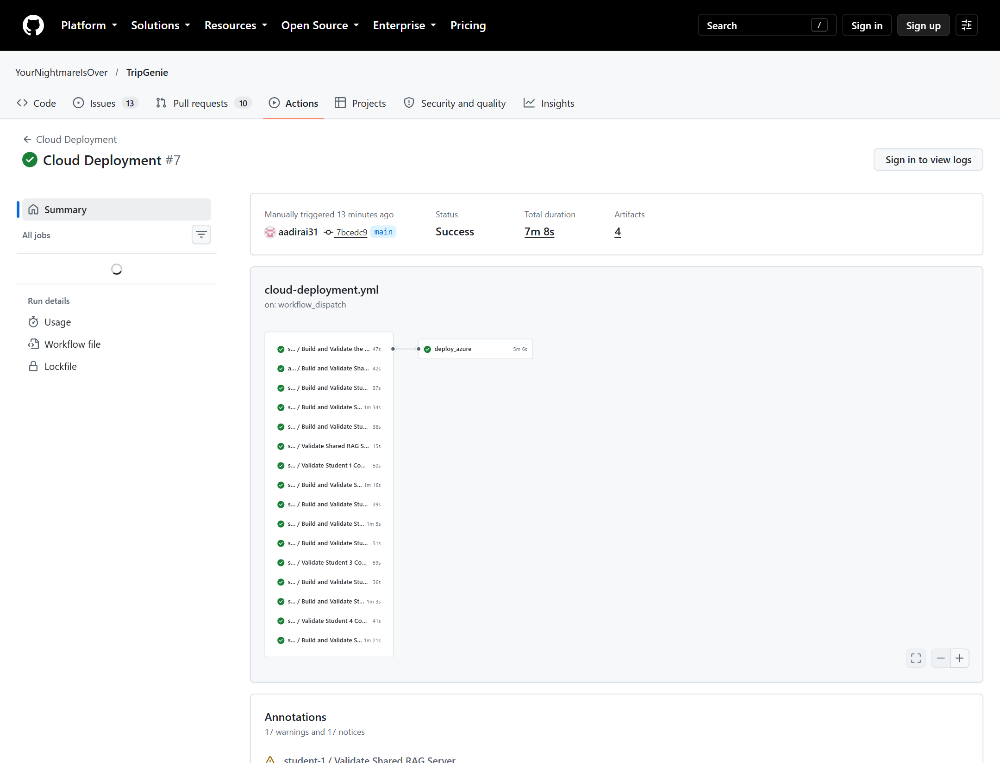
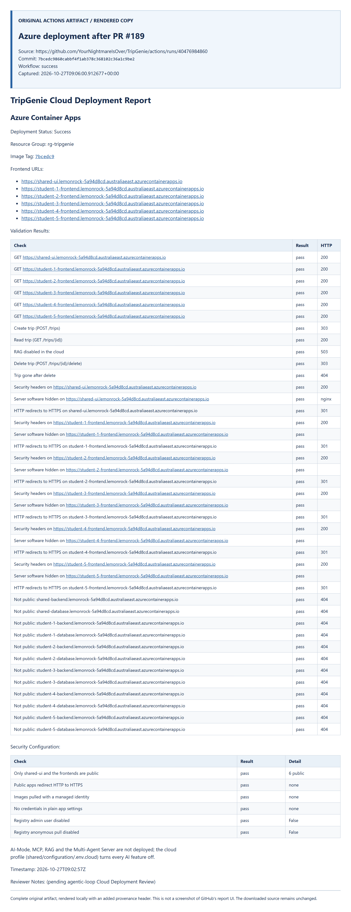
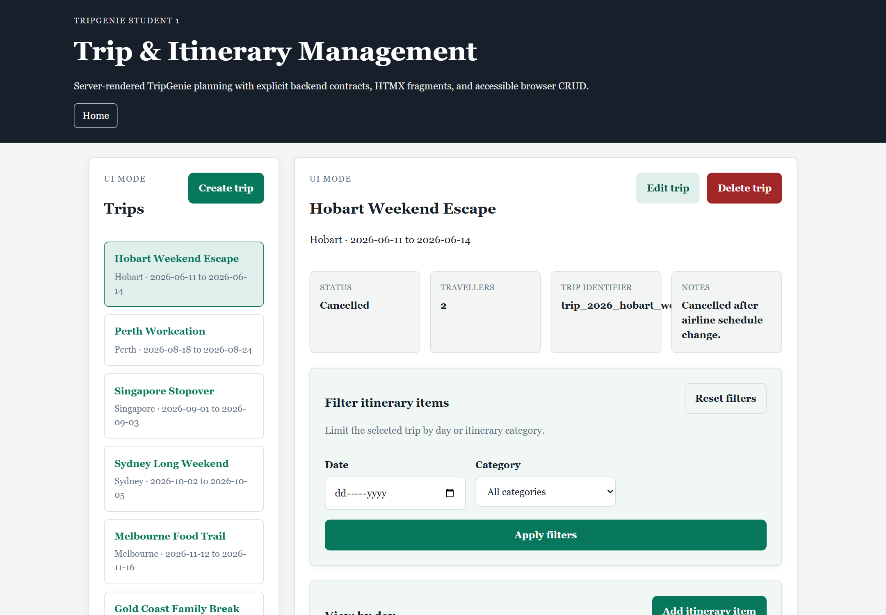

# TripGenie Release 2 Cloud Deployment Report

> **Updated 27 October 2026 after the successful deployment of PR #189.**
> Refs #171. This report describes the verified cloud baseline, not a claim
> that all group assessment evidence is complete. Earlier 21 October evidence
> is preserved separately and is not presented as the current deployed state.

## At a glance

| Item | Verified state on 27 October 2026 |
| --- | --- |
| Deployed application | `7bcedc9860cabbf4f1ab378c368102c36a1c9be2`, the merge of [PR #189](https://github.com/YourNightmareIsOver/TripGenie/pull/189) into `main` |
| Cloud Deployment | [Run 40476984860](https://github.com/YourNightmareIsOver/TripGenie/actions/runs/40476984860), successful; 08:55:54-09:03:02 UTC (completed 20:03:02 AEDT) |
| Azure revision gate | All 18 applications use the intended full-SHA image; each latest revision is also its latest ready revision |
| Public frontends | Six HTTPS frontends returned HTTP 200; fresh browser screenshots captured after deployment |
| Automated deployment results | 41 validation checks and six security-configuration checks passed |
| Student 1 post-commit tests | Seven passed at the deployed SHA; zero failures, errors or skips; JUnit suite time 0.220 seconds |
| Current observed cost | AUD 35.72 returned for `rg-tripgenie`; usage through 27 October is partial because of billing lag |
| Review and approval | The 26 October review records Accept / READY for the earlier deployment. The 27 October rollout was explicitly authorized; it is not mislabelled as a new model review |
| Cloud AI boundary | No AI services deployed. Student 1 AI controls are disabled/hidden; direct Student 3/5 AI paths remain unavailable rather than explicitly switched off |

## Report narrative (for the group PDF)

TripGenie's cloud baseline runs on Azure Container Apps in Australia East,
using the Consumption profile of `tripgenie-env`. Lab 11-style shell scripts
render 18 applications from Docker Compose: five frontend/backend/database
slices and the shared portal, reference API and database. Six frontends
expose public HTTPS endpoints; twelve backend/database services use internal
TCP ingress. Each feature frontend calls its own backend, and each backend
owns access to its database service. The portal provides navigation links,
not an API proxy.

Docker images are stored in Azure Container Registry with full commit-SHA
tags. GitHub Actions authenticates to Azure through OIDC federation; the
`tripgenie-acr-pull` managed identity has registry-scoped image-pull access.
Registry admin and anonymous access are disabled. The development flow is
source control, local pre-commit security scans, GitHub Actions post-commit
tests and Docker validation, followed by a manually dispatched
`cloud-deployment.yml`. Deployment reruns all seven reusable service
workflows before building, pushing and releasing images. A revision gate
checks the intended image on the newest ready revision rather than accepting
an older healthy revision.

On 27 October 2026, run **40476984860** successfully deployed commit
**7bcedc9**, including merged PR #189. All 18 applications were independently
confirmed at that image with their latest revisions ready. The generated
report records **41 passing validation checks and six passing
security-configuration checks**. All public frontends returned HTTP 200.
Student 1's trip create/read/delete flow succeeded, deletion was confirmed,
and its disabled RAG route returned HTTP 503. Student 1's seven HTTP endpoint
tests also passed at the deployed commit, covering trip creation and
itinerary-item creation with valid and invalid inputs.

The cloud remains a non-AI baseline: AI-Mode, MCP, RAG, Ollama and the
Multi-Agent Server run locally, not in Azure. Student 1 hides its disabled
AI controls; direct AI calls in Students 3 and 5 still target an unavailable
host-only service. SQLite data is ephemeral, frontends can cold-start, and
application logs are not routed to Log Analytics. Observed resource-group
cost was **AUD 35.72**, including a partial 27 October billing row.

The earlier Cloud Deployment Review records Accept / READY for the
23 October deployment, while this newer rollout has separate automated
evidence and explicit human deployment authorization. The current
`production` environment permits only `main` but has no required-reviewer
rule. Dedicated endpoint artifacts are present for Students 1, 3 and 5,
not 2 and 4; deployment success must not conceal these evidence gaps.

## Azure reference architecture

*Figure 1. Azure reference architecture for deployed source `7bcedc9`.
Grouped student boxes represent five distinct applications. Internal ingress
is not per-service authorization, and OIDC is deployment authentication,
not application-user authentication.*

[Editable SVG](cloud-evidence/architecture/azure-reference-architecture.svg).
The implementation uses ACR, shell scripts and ephemeral SQLite: not GHCR,
Bicep or an Azure Files database mount. The stale Bicep comment in the cloud
profile does not describe the actual deployment implementation.

## DevOps flow

*Figure 2. Source-to-cloud delivery, with missing endpoint artifacts and the
unconfigured required-reviewer rule explicitly marked.*

[Editable SVG](cloud-evidence/architecture/cicd-deployment-flow.svg).
The local security gate uses Ruff security rules, detect-secrets and pip-audit.
The assessment requires tests for two backend/API functions per student;
Student 1 tests `POST /api/trips` and
`POST /api/trips/{trip_id}/itinerary-items` against its real Compose stack.
The successful cloud run reused shared, AI-Mode and all five student workflows.
A failed prerequisite job prevents deployment.

The deploy job runs in `production`, authenticates with `azure/login`, builds
and pushes images, updates Container Apps, checks revision readiness, and
publishes the validation report. See the [actual step timings and revision
table](cloud-evidence/2026-10-27/run-summary.md), rather than treating a diagram
as execution evidence.

## Current deployment screenshots

*Figure 3. Actual public GitHub Actions run page, captured after completion.
The displayed run number is #7; its API run ID is 40476984860. Runner/action
deprecation warnings remain visible and are not represented as failures.*

*Figure 4. Complete downloaded deployment artifact rendered in a browser,
with an added provenance header. This is explicitly a rendered artifact,
not a fabricated GitHub report screen. The
[original Markdown](cloud-evidence/2026-10-27/cloud-deployment-results.md)
retains all text, including the original pending-review sentence.*

*Figure 5. Student 1's real Azure frontend after deployment.
[All six frontend captures](cloud-evidence/2026-10-27/run-summary.md#live-frontend-screenshots)
record URLs, titles, HTTP results and capture times. These read-only captures
do not claim a fresh full CRUD cycle for Students 2-5.*

## AI-off configuration

The [read-only Azure snapshot](cloud-evidence/2026-10-27/azure-state.json)
contains selected non-secret AI settings and the deployed image for every app.

| Scope | Current configuration and interpretation |
| --- | --- |
| Shared AI services | AI-Mode, Ollama, MCP, RAG, Multi-Agent Server and the local review loop are absent from the 18-app cloud inventory |
| Student 1 | AI-Mode URL omitted; RAG, MCP and Multi-Agent flags false. #190's visibility fix is merged and deployed; the newly merged planner remains disabled by the cloud profile |
| Student 2 | AI-Mode/RAG URLs omitted; `MULTI_AGENT_ENABLED=false` |
| Student 3 | RAG, MCP and Multi-Agent flags false. Direct AI-Mode URL remains `http://host.docker.internal:8006`: unavailable, not explicitly disabled |
| Student 4 | MCP/assistant, RAG and Multi-Agent flags false. Its assistant flag is read from `STUDENT4_BACKEND_MCP_ENABLED`; the configured host AI URL sits behind that flag |
| Student 5 | RAG, MCP and Multi-Agent flags false. Direct AI-Mode URL remains `http://host.docker.internal:8006`: unavailable, not explicitly disabled |

The workflow live-tested Student 1 RAG's HTTP 503. No model or other AI
endpoint was invoked for these screenshots. The artifact's generic statement
that every AI feature is off must be read with the direct-path exceptions
above; it does not prove every feature was exercised.

## Final human release decision

The [26 October Cloud Deployment Review](https://github.com/YourNightmareIsOver/TripGenie/blob/2085a97cc5a548765ba8a363d960cdb0bdff092f/docs/reports/release-2/agentic-loop/cloud-review.md)
contains deterministic checks, real implementation/review-agent sections and
the recorded human decision **Accept. Release decision: READY**. Its source
was run **39911331439 at `4ed8621`**, not the newer rollout.

On 27 October, Student 1 explicitly instructed **"merge and deploy PR 189"**,
then **"update PR 186 and merge when done"**. These authorize the new rollout
and publication of its verified report. They are not represented as a new
interactive agentic-loop acceptance or approval of every assessment criterion.
The new run's unchanged artifact still says its review is pending.

The earlier review claims that a reviewer gate exists. Direct GitHub API
evidence now shows only the [`main` branch policy](cloud-evidence/2026-10-27/production-branch-policy.json)
and [no required-reviewer rule](cloud-evidence/2026-10-27/production-environment.json).
The environment name alone does not enforce human approval. This qualification
does not rewrite or revoke the earlier recorded human decision.

## Ownership

| Area | Contribution |
| --- | --- |
| Shared Azure deployment, cloud profile, OIDC, registry pull identity, revision gate and report | Student 1; #179, #180, #187 and this report |
| Student 1 endpoint tests, AI visibility and multi-agent planner | Student 1; #181, #190 and #189 |
| Shared frontend security headers and deployment security checker | Includes Student 5's #195; not reattributed to Student 1 |
| Agentic-loop Cloud Deployment Review | Shared review implementation and its recorded reviewer/human outputs |
| Feature CRUD | Each student owns the implementation for their slice |

## Evidence index

| Evidence | Source and scope |
| --- | --- |
| Current run, all steps and 18 intended-image revisions | [Run summary](cloud-evidence/2026-10-27/run-summary.md), [workflow](https://github.com/YourNightmareIsOver/TripGenie/actions/runs/40476984860) |
| Complete validation/security report | [Unchanged original artifact](cloud-evidence/2026-10-27/cloud-deployment-results.md) |
| Student 1 endpoint evidence at `7bcedc9` | [Markdown](cloud-evidence/2026-10-27/student-1-endpoint-tests.md), [JUnit XML](cloud-evidence/2026-10-27/student-1-endpoint-tests.xml), [screenshot](cloud-evidence/2026-10-27/screenshots/student-1-endpoint-tests.png) |
| All current frontend screenshots | [Capture index](cloud-evidence/2026-10-27/run-summary.md#live-frontend-screenshots) |
| Current Azure settings | [Apps and AI flags](cloud-evidence/2026-10-27/azure-state.json), [environment](cloud-evidence/2026-10-27/environment-state.json), [registry](cloud-evidence/2026-10-27/registry-state.json) |
| Production protections | [Environment rules](cloud-evidence/2026-10-27/production-environment.json), [branch policy](cloud-evidence/2026-10-27/production-branch-policy.json) |
| Current observed cost | [AUD 35.72 with date/scope caveats](cloud-evidence/2026-10-27/cost-summary.md) |
| Capture integrity | [Source run, finalized capture time and file SHA-256 hashes](cloud-evidence/2026-10-27/capture-manifest.json) |
| Cloud review and recorded decision | [26 October review](https://github.com/YourNightmareIsOver/TripGenie/blob/2085a97cc5a548765ba8a363d960cdb0bdff092f/docs/reports/release-2/agentic-loop/cloud-review.md), covering the earlier deployment |
| Local real-model workflow, separate from cloud | [Student 1 runtime evidence](student-1-multi-agent-runtime-evidence.md) |
| Pre-commit security and test implementation | [Security report](student-1-pre-commit-security-report.md), [endpoint report](student-1-post-commit-testing-report.md) |
| Earlier deployment and Students 2-5 CRUD | [21 October run](cloud-evidence/run-39580927565-summary.md), [28 passing historical manual checks](cloud-evidence/live-checks-2026-10-21.md) |
| Commit/contribution log with dates | [PR #206](https://github.com/YourNightmareIsOver/TripGenie/pull/206), a separate evidence snapshot |

## Known limitations

- **Persistence and scaling:** SQLite uses ephemeral container storage; restarts
  or redeployment can reset data. Internal apps use one replica; public
  frontends have minimum zero and can cold-start.
- **Observability:** the environment has no app-log destination. This report
  uses workflow logs, artifacts and point-in-time Azure/browser reads.
- **Security scope:** public endpoints are not application-user authentication.
  Internal ingress is not service-level authorization. The portal returns an
  unversioned `nginx` header; the passing banner check does not mean every
  server header is absent. The credential-name check is not an exhaustive
  secret audit. A public-domain 404 is considered alongside ingress configuration.
- **AI:** merging #189 does not deploy its host services or enable cloud AI.
  Direct Student 3/5 AI paths remain unavailable; see the exact table above.
- **Cost:** AUD 35.72 is observed resource-group usage, not a monthly forecast.
  The 27 October row is partial and does not establish this rollout's final cost.
- **Coverage:** the cloud workflow automates Student 1 CRUD, not every feature's
  full CRUD flow. Historical manual checks are kept distinct from today's
  frontend reads. Student 5 expenses and Student 4 itinerary links are not
  newly certified by these screenshots.
- **Historical fixes:** #187 resolved placeholder-image revisions and
  incorrectly generated HTTP links. The current 18-image readiness evidence
  confirms the intended image gate remains effective.

## Pending evidence

The cloud rollout and this report's captures are complete. Remaining group
assessment qualifications are explicit rather than replaced with invented
evidence:

1. A fresh interactive Cloud Deployment Review/human decision specifically
   for `7bcedc9` is not claimed; the existing accepted review covers `4ed8621`.
2. The current run's [artifact index](cloud-evidence/2026-10-27/artifact-index.json)
   contains dedicated endpoint artifacts for Students 1, 3 and 5, but not 2
   and 4. A green shared deployment does not satisfy those missing artifacts.
3. The video was recorded as confirmed by Student 1. Its final published URL
   still needs to be included in the group submission; no URL was invented.
