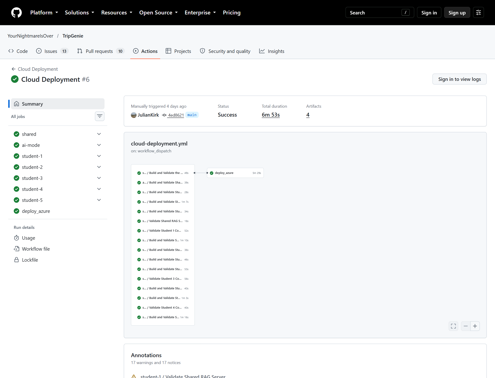
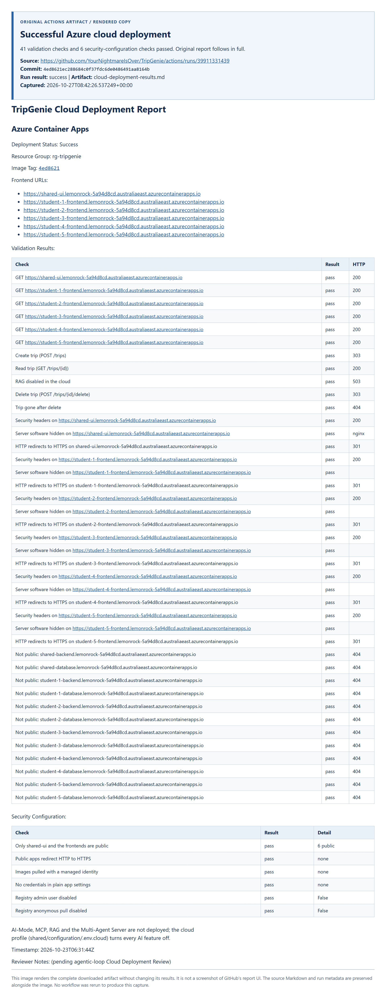

# Student 1 Release 2: CI/CD and cloud deployment evidence

Evidence collected on **27 October 2026** from completed GitHub Actions runs.
The runs themselves occurred on **23 October**; no tests or cloud deployment
were rerun to produce these screenshots.

This pack supplies report-ready explanations, screenshots, the complete
original report text and JUnit results, exact run/commit references, and a
[Student 1 commit log](student-1-release-2-commit-log.md).

## Evidence and version index

| Evidence | Run / job | Application commit | Observed result |
| --- | --- | --- | --- |
| Student 1 feature-branch CI | [Run 39887108168](https://github.com/YourNightmareIsOver/TripGenie/actions/runs/39887108168), [Compose/endpoint job](https://github.com/YourNightmareIsOver/TripGenie/actions/runs/39887108168/job/120197749318) | `29239a10763950c8beeea6a80d0c4b327c0ce784`, PR #189 | Workflow success; 7 endpoint tests passed |
| Student 1 CI for the deployed version | [Cloud run's Student 1 job](https://github.com/YourNightmareIsOver/TripGenie/actions/runs/39911331439/job/120274794975) | `4ed8621ec288684c0f37fdc6de0486491aa8164b`, `main` | 7 endpoint tests passed before deployment |
| Azure deployment | [Run 39911331439](https://github.com/YourNightmareIsOver/TripGenie/actions/runs/39911331439), [deploy job](https://github.com/YourNightmareIsOver/TripGenie/actions/runs/39911331439/job/120275210460) | `4ed8621ec288684c0f37fdc6de0486491aa8164b`, `main` | Workflow success; 41 validation checks and 6 security-configuration checks passed |

**These are not all the same application version.** The feature-branch CI
includes the unmerged Student 1 planner work. The cloud deployment does not.
The extra Student 1 endpoint artifact from the cloud run supplies matching-SHA
test evidence for the deployed application.

## Post-commit CI/CD testing

### Text for the group report

Student 1's post-commit CI/CD tests exercise two backend functions:
`POST /api/trips` and `POST /api/trips/{trip_id}/itinerary-items`. The
`student-1-ci.yml` workflow starts the real frontend, backend and SQLite
database services through Docker Compose and runs HTTP endpoint tests.
The cases check successful creation and persisted reads, invalid trip dates,
missing required fields, unknown trips and itinerary dates outside the trip.
An unreachable backend or failed assertion fails the endpoint-test step.
JUnit XML and a Markdown result table are uploaded as
`student-1-endpoint-test-evidence`, including when the tests fail.

Run **39887108168**, triggered by a pull-request update to PR #189, completed
successfully on 23 October 2026 at commit `29239a1`. All **seven endpoint
tests passed, with zero failures, errors or skips**. The JUnit suite took
**0.204 seconds**; this is test execution time, not the complete CI workflow
duration. Separately, the deployment workflow reran Student 1's tests at
the deployed commit `4ed8621`, with **seven passes and no failures, errors
or skips** in **0.155 seconds**.

### Screenshot 1: actual GitHub Actions run page

*Figure 1. Unmodified browser viewport capture of the public
[Student 1 CI run](https://github.com/YourNightmareIsOver/TripGenie/actions/runs/39887108168).
The GitHub run number shown in the heading is #445; the API run ID is
39887108168. The page also contains runner/action deprecation warnings;
workflow success does not mean there were no warnings. Public viewers may
need to sign in to open individual job logs.*

### Screenshot 2: complete endpoint-test report

*Figure 2. Browser-rendered copy of the complete original Markdown artifact,
with an added provenance header. This is not a fabricated GitHub UI screenshot.
The source report and machine-readable JUnit result are preserved below.*

| Function | Cases covered | Result |
| --- | --- | --- |
| Create trip | Valid fields persist and can be read; created trip is listed; reversed date range rejected; missing name rejected | 4 passed |
| Create itinerary item | Valid item appears on its trip day; unknown trip rejected; date outside the trip rejected | 3 passed |

Original files:

- [Complete feature-branch test report](student-1-report-evidence/ci/student-1-endpoint-tests.md)
- [Feature-branch JUnit XML](student-1-report-evidence/ci/student-1-endpoint-tests.xml)
- [Feature-branch run/job/step metadata](student-1-report-evidence/ci/run-metadata.json)
- [Deployed-version test report](student-1-report-evidence/cloud-student-1-ci/student-1-endpoint-tests.md)
- [Deployed-version JUnit XML](student-1-report-evidence/cloud-student-1-ci/student-1-endpoint-tests.xml)

The existing [post-commit testing report](student-1-post-commit-testing-report.md)
explains the implementation and earlier deliberate-failure demonstration.
This pack adds newer, version-labelled evidence; it does not rewrite those
historical results.

## Successful cloud deployment

### Text for the group report

The shared Cloud Deployment workflow **39911331439** successfully deployed
commit `4ed8621` to **Azure Container Apps** in `rg-tripgenie` on 23 October
2026. Its generated report records **41 passing validation checks** and
**six passing security-configuration checks**. All six public frontends
returned HTTP 200. Student 1's trip create, read and delete flow succeeded,
and a subsequent read confirmed deletion. The disabled RAG route returned
HTTP 503 as expected.

The deployment also checked frontend security headers, HTTP-to-HTTPS
redirects, and public-domain responses for all twelve internal backend and
database services. Configuration validation confirmed that only the six
frontends were public, image pulls used a managed identity, the targeted
plain-setting credential check passed, and registry admin and anonymous
access were disabled. The report states that AI-Mode, MCP, RAG and the
Multi-Agent Server were not deployed. These results establish the outcome
of this specific deployment, not continuous monitoring or cloud AI execution.

### Screenshot 3: actual successful deployment run

*Figure 3. Unmodified browser viewport capture of
[Cloud Deployment run 39911331439](https://github.com/YourNightmareIsOver/TripGenie/actions/runs/39911331439),
shown as run #6 in the GitHub heading. The screenshot records the actual
dispatcher of this shared run; it is not a claim that Student 1 personally
triggered it. Student 1's implementation contributions are attributed through
the linked commit log.*

### Screenshot 4: complete generated deployment report

*Figure 4. Browser-rendered copy of the complete downloaded
`cloud-deployment-results.md`, with an added provenance header. The image
includes every validation/security row, frontend URL, deployment timestamp,
AI-off statement and original reviewer note. Open the image at full resolution
to read it, or use the accompanying Markdown rather than shrinking the entire
long image onto one PDF page.*

Original files:

- [Complete generated cloud report, including all accompanying text](student-1-report-evidence/cloud/cloud-deployment-results.md)
- [Deployment workflow/job/step metadata](student-1-report-evidence/cloud/run-metadata.json)

### Interpretation and boundaries

- The artifact's timestamp is `2026-10-23T06:31:44Z` (17:31:44 AEDT).
  Screenshot capture occurred on 27 October; it does not imply a new deployment.
- The original `Reviewer Notes: (pending agentic-loop Cloud Deployment Review)`
  line is preserved, rather than editing the downloaded artifact. A subsequent
  [26 October Cloud Review](https://github.com/YourNightmareIsOver/TripGenie/blob/2085a97cc5a548765ba8a363d960cdb0bdff092f/docs/reports/release-2/agentic-loop/cloud-review.md)
  records Accept / READY. That is a separate review and human decision.
- A public-domain 404 is not sufficient proof of isolation on its own; use it
  alongside the internal-ingress configuration result.
- The portal still returns the unversioned `nginx` header. The artifact's
  passing banner check does not mean every server header is absent.
- The plain-setting credential scan checks credential-like environment names.
  It is not proof that every possible secret has been exhaustively audited.
- The `production` environment reference does not itself enforce a reviewer.
  A read-only check on 27 October found the `main` branch policy but no
  required-reviewer rule. These successful run screenshots must not be used
  as proof that required-reviewer protection is currently enabled.
- Frontend CRUD results do not prove durable database storage across a restart
  or deployment; the deployed SQLite data is ephemeral.
- Shared security-header and checker contributions include Student 5's #195.
  This report does not reattribute those changes to Student 1.

## Commit logs and use in the final report

The [commit-log table](student-1-release-2-commit-log.md) lists **31 original
commits across nine Student 1 Release 2 PRs**, with exact subjects, dates,
commit links and PR references. A separate table identifies each PR's merge
status and main integration SHA. Open work is not labelled merged or deployed.

For the group PDF, use the two report-ready text sections above, suitable
figures/captions, the run URLs and selected rows from the contribution table.
Link the full raw reports and commit table for the supporting detail. No
deployment approval or final team decision is created by this evidence pack.

## Capture provenance

[capture-manifest.json](student-1-report-evidence/capture-manifest.json)
records the capture time, source runs, screenshot types, file sizes and
SHA-256 hashes. A directory-scoped `.gitattributes` disables newline conversion
so the original artifact bytes and hashes survive checkout on other platforms.
The screenshots were made with real Chrome through Playwright.
The public GitHub run pages were captured without DOM editing. The full
artifact screenshots were rendered from the downloaded Markdown through
GitHub's Markdown renderer and a locally styled document, explicitly labelled
as rendered copies. No test result, report row or decision was invented.
